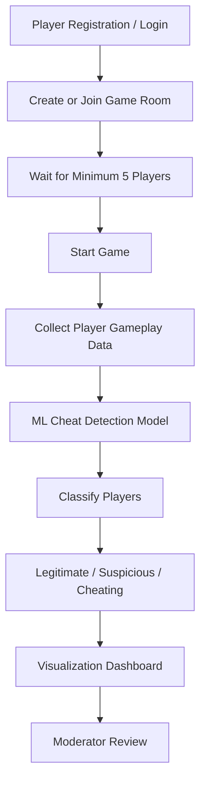

# Multiplayer In-Game Cheat Detection System
### Academic College Project — Production-Ready Web Application & Machine Learning Platform

---

## 📌 Main Concept & Executive Overview

Online competitive multiplayer gaming is heavily affected by unauthorized third-party cheats such as **aimbots**, **triggerbots**, **speedhacks**, and **rapid-fire macros**. This project builds an end-to-end **Multiplayer In-Game Cheat Detection System** designed for academic evaluation, research, and viva demonstration.

---

## 🔄 End-to-End System Pipeline Flowchart



### Detailed Flowchart Node Mapping

| Node | Stage | Implementation & Technical Specs |
| :--- | :--- | :--- |
| **A** | **Player Registration / Login** | Secure authentication with Werkzeug password hashing. Roles distinguish combatants (`player`) from forensic auditors (`moderator`). Seeded accounts: `player1` to `player5` & `moderator1` (pw: `password123`). |
| **B** | **Create or Join Game Room** | Match lobby system with unique dynamic room codes (`ARENA-XX`). Players browse active rooms, join rosters, and signal ready status. |
| **C** | **Wait for Minimum 5 Players** | **Strict 5-Player Quorum Gate**. Match start button remains locked until at least 5 registered players join and ready up. Includes "Quick-Fill 5 Players (Demo)" for presentations. |
| **D** | **Start Game** | Match launch control restricted exclusively to Room Host. Locks lobby and triggers simultaneous telemetry collection. |
| **E** | **Collect Player Gameplay Data** | Extracts 9 kinematic telemetry dimensions per player: Kills, Deaths, KDR, Headshot %, Accuracy %, Reaction Time (ms), Speed, Actions/sec, Duration. Distinguishes live play (`is_simulated = 0`) from simulation (`is_simulated = 1`). |
| **F** | **ML Cheat Detection Model** | 120-tree Random Forest classifier with `StandardScaler` feature normalization, trained on 3,500 kinematic match records (99.86% accuracy). |
| **G** | **Classify Players** | Evaluates decision tree vote consensus to output posterior cheat probability % (0.0% to 100.0%) and detects rule-based kinematic anomalies (e.g. sub-120ms reaction, aimbot snaps). |
| **H** | **Legitimate / Suspicious / Cheating** | **3-Tier Categorization**: <br>• 🟢 **Legitimate**: Normal human limits (Reaction 180–350ms, Accuracy <60%, Prob <35%)<br>• 🟡 **Suspicious**: Borderline anomalies (Prob 35–70%, APS >12) queued for audit<br>• 🔴 **Cheating**: Blatant cheat signatures (Reaction <120ms, Headshot ≥70%, Prob ≥70%). |
| **I** | **Visualization Dashboard** | Real-time analytics with 4 Chart.js visualizations: 1) Bar Chart (Player vs Probability), 2) Doughnut Chart (3-Tier ratio), 3) Scatter Plot (Accuracy vs Reaction Time clustering), 4) Line Chart (Match telemetry trends) + 5 KPI counters and searchable table. |
| **J** | **Moderator Review** | **Human-in-the-Loop Audit Center**. Flagged players (`Suspicious` and `Cheating`) are queued for human forensic investigation. Human moderators inspect anomaly flags and submit binding verdicts: `Confirmed Cheating`, `Legitimate (Cleared)`, or `Needs Further Review`. **Strictly no automated bans**. |

---

### Key Functional Highlights
- **Multiplayer Room Lobby**: Players can register, log in, create or join multiplayer match rooms with dynamic room codes.
- **Strict 5-Player Quorum**: Matches **require a minimum of 5 players** before the game can start. The Start Game control is disabled for everyone except the Room Host, and stays locked until the 5-player threshold is met (e.g. `3/5` -> `5/5`).
- **One-Click Demo Quick-Fill**: For college presentations when 5 physical devices/browser tabs are impractical, a built-in *Quick-Fill 5 Players* button instantly populates the room with realistic players to demonstrate the locked-to-unlocked transition and game launch in seconds.
- **Interactive Target Reflex Mini-Game**: Built-in 2D playable shooting range tracking authentic human reaction times, bullseye headshot percentage, accuracy, and actions per second.
- **Random Forest Machine Learning Classifier**: Analyzes multiplayer gameplay telemetry, predicts whether each player is **Legitimate** or **Suspicious**, and calculates an exact **Cheat Probability %** and risk tier (**Low**, **Medium**, **High**).
- **Interactive Data Visualizations (Chart.js)**:
  1. **Bar Chart**: Cheat probability per player.
  2. **Pie Chart**: Legitimate vs. Suspicious distribution.
  3. **Scatter Plot**: Player Accuracy (%) vs. Reaction Time (ms) clustering human vs. superhuman bot performance.
  4. **Line Chart**: Telemetry metric trends across recent matches.
- **Human-in-the-Loop Moderator Dashboard**: Flagged players are routed to a moderator audit queue. Human moderators inspect telemetry and record official verdicts (`Confirmed Cheating`, `Legitimate`, or `Needs Further Review`). The system **never issues automated bans solely based on ML predictions**.
- **Telemetry Distinction**: Real interactive gameplay telemetry (`is_simulated = 0`) is clearly distinguished from synthetic simulation batches (`is_simulated = 1`).

---

## 🛠️ Technology Stack

| Component | Technology | Description |
| :--- | :--- | :--- |
| **Frontend UI** | React 18, Tailwind CSS, FontAwesome | Modern dark gaming theme with neon blue (`#3b82f6`) and purple (`#8b5cf6`) accents, responsive cards, modals, and tables. |
| **Data Graphs** | Chart.js 4.x | Interactive Bar, Pie, Scatter (Accuracy vs Reaction Time), and Line charts. |
| **Backend API** | Python Flask | Lightweight REST API server handling authentication, lobby sessions, match orchestration, and ML inference. |
| **Database** | SQLite 3 | Relational schema with tables: `users`, `game_rooms`, `game_players`, `gameplay_stats`, `detection_results`, `moderator_reviews`. |
| **Machine Learning** | Scikit-learn, Random Forest, Pandas, Joblib | 100-tree ensemble classifier with standard feature scaling, trained on realistic multiplayer telemetry. |

---

## 📁 Project Architecture & File Structure

```
InGame-Cheat-Detection/
│
├── dataset/
│   ├── multiplayer_gameplay_dataset.csv   # 3,500-record synthetic multiplayer gameplay dataset
│   └── final_dataset.csv                  # Kinematic raw telemetry reference dataset
│
├── ml/
│   ├── train_rf_model.py                  # Random Forest dataset generator & model training pipeline
│   └── model/
│       ├── random_forest_cheat_detector.pkl  # Trained Random Forest classifier
│       ├── rf_scaler.pkl                     # Standard scaler
│       └── rf_metadata.json                  # Accuracy, F1, ROC-AUC & feature importances
│
├── backend/
│   ├── app.py                             # Flask application & complete REST API endpoints
│   ├── database.py                        # SQLite schema initialization & connection manager
│   ├── prediction.py                      # Random Forest inference engine & anomaly flags
│   └── game_sim.py                        # Match simulation engine & quick-fill demo accelerator
│
├── templates/
│   └── index.html                         # Unified Single-Page Application (React 18 + Tailwind + Chart.js)
│
├── database/
│   └── schema.sql                         # Relational SQLite table definitions
│
├── tests/
│   └── test_multiplayer_system.py         # Automated unit and integration test suite
│
├── requirements.txt                       # Python dependencies
└── README.md                              # Complete setup, execution, & viva guide
```

---

## 🗄️ Relational Database Schema

The SQLite database (`database/multiplayer_anti_cheat.db`) creates 6 interconnected tables:

1. **`users`**: Unique player & moderator credentials, hashed passwords (`werkzeug.security`), roles, and avatar colors.
2. **`game_rooms`**: Match lobbies, room codes (`ARENA-XX`), host user ID, status (`waiting`, `in_progress`, `completed`), and min/max player constraints (`min_players = 5`).
3. **`game_players`**: Active players assigned to rooms, host flag, and ready state.
4. **`gameplay_stats`**: Telemetry records (`kills`, `deaths`, `kdr`, `headshot_pct`, `accuracy_pct`, `reaction_time_ms`, `movement_speed`, `actions_per_second`, `session_duration_s`, `is_simulated`, `cheat_profile`).
5. **`detection_results`**: ML predictions (`Legitimate` / `Suspicious`), `cheat_probability` (0–100%), `risk_level` (`LOW` / `MEDIUM` / `HIGH`), anomaly flags, model metadata.
6. **`moderator_reviews`**: Human moderator audit logs (`decision`: `Confirmed Cheating`, `Legitimate`, `Needs Further Review`), notes, and disciplinary action taken.

---

## 🚀 Setup & Execution Guide

### Step 1: Install Dependencies
Open your PowerShell or Command Prompt in the project folder and run:
```bash
py -m pip install -r requirements.txt
```
*(Or `pip install -r requirements.txt` depending on your Python installation).*

### Step 2: (Optional) Retrain the Machine Learning Model
The production Random Forest model and scaler are pre-trained and saved in `ml/model/`. To re-generate the dataset and retrain from scratch:
```bash
py ml/train_rf_model.py
```
*Trained model metrics: Accuracy: 99.86% | Precision: 99.53% | Recall: 100% | F1: 99.76% | ROC-AUC: 1.0000.*

### Step 3: Launch the Flask Backend Server
```bash
py backend/app.py
```
You will see:
```text
* Running on http://127.0.0.1:5000
* Running on http://<your-ip>:5000
```

### Step 4: Access the Application in Your Browser
Open your browser and navigate to:
```
http://127.0.0.1:5000
```

---

## 🔑 Default Demonstration Accounts

The database automatically seeds standard test accounts (password for all accounts is `password123`):

| Username | Role | Purpose |
| :--- | :--- | :--- |
| `player1` | Player (Default Host) | Match host, room creation, gameplay simulation |
| `player2` | Player | Multiplayer participant |
| `player3` | Player | Multiplayer participant |
| `player4` | Player | Multiplayer participant |
| `player5` | Player | Multiplayer participant |
| `moderator1` | Moderator | Forensic audit queue, telemetry review, case verdicts |

*You can also register any new unique username directly from the UI modal.*

---

## 🎮 Step-by-Step Demonstration Walkthrough for Viva

### 1. Multiplayer Lobby & 5-Player Validation
1. Log in as `player1` (`password123`).
2. Go to the **Lobby** tab.
3. Click **Create Room** or select the pre-seeded room `ARENA-01`.
4. Observe the player progress bar:
   - Notice the **Start Match** button is **disabled** with the warning: *"Requires at least 5 players to start"*.
   - Only the host has the authority to start the match.
5. Click the green **"Quick-Fill 5 Players (Demo)"** button.
   - The room capacity indicator transitions to `5/5 Ready`.
   - The **Start Match** button unlocks with a glowing neon accent.
6. Click **Start Match (5 Players)**.
   - The backend runs the match simulation across all 5 players, extracts telemetry, executes the Random Forest model, and records detection results in the database.

### 2. Interactive Target Reflex Mini-Game (Live Human Play)
1. Switch to the **Reflex Range** tab.
2. Click **Start 30s Drill**.
3. Targets will appear dynamically across the arena. Click targets as fast as possible to record your authentic biological reaction times, click accuracy, and headshot precision.
4. When finished, click **Analyze with ML (Human Play)**.
   - Telemetry is sent via `POST /api/gameplay/submit-live` with `is_simulated = 0`.
   - The Random Forest model evaluates your score live and displays your cheat probability and risk classification.

### 3. Live Detection Dashboard & Interactive Charts
1. Switch to the **Live Dashboard** tab.
2. View real-time KPI cards:
   - Total Players Evaluated
   - Legitimate Players Count
   - Suspicious Players Count
   - Platform Average Cheat Probability
3. Inspect the four interactive **Chart.js** visualizations:
   - **Bar Chart**: Cheat probability (%) per player.
   - **Pie Chart**: Visual distribution of legitimate vs. suspicious players.
   - **Scatter Plot (Accuracy vs Reaction Time)**: Notice how human players cluster at 180–300ms reaction times and 35–65% accuracy, whereas aimbot/triggerbot cheaters cluster at superhuman <120ms reaction times and >85% accuracy.
   - **Line Chart**: Evolution of telemetry metrics over consecutive matches.
4. Browse the telemetry table with instant search and status badges.

### 4. Moderator Review & Audit Workflow (Human-in-the-Loop)
1. Log out or switch to `moderator1` (`password123`).
2. Navigate to the **Moderator Review** tab.
3. The queue displays all players flagged as **Suspicious** by the ML model.
4. Click **Investigate** on any flagged player:
   - Review kinematic anomalies (e.g., *Sub-human reaction speed*, *Aimbot snap*, *Macro fire rate*).
   - Enter investigator notes.
   - Select an official decision: **`Confirmed Cheating`**, **`Legitimate`**, or **`Needs Further Review`**.
   - Select an administrative action: `Under Observation`, `Warning Issued`, or `Account Suspended`.
5. Click **Submit Official Review**. The review is permanently saved to `moderator_reviews` and reflected in the live queue.

---

## 🤖 Machine Learning Model Details

- **Algorithm**: Random Forest Classifier (`sklearn.ensemble.RandomForestClassifier`)
- **Estimators**: 100 decision trees
- **Feature Pipeline**:
  - `kills`, `deaths`, `kdr` (Kill/Death Ratio)
  - `headshot_pct` (% headshot accuracy)
  - `accuracy_pct` (overall hit percentage)
  - `reaction_time_ms` (time in milliseconds from target visibility to trigger pull)
  - `movement_speed` (in-game kinematic units/sec)
  - `actions_per_second` (input frequency)
  - `session_duration_s` (match duration)
- **Primary Importance Signals**:
  1. `reaction_time_ms`: Sub-human response times (<120ms) strongly distinguish bots from human physiology.
  2. `headshot_pct`: Statistical divergence from normal bell-curve distributions indicates aim locking.
  3. `accuracy_pct`: Sustained high accuracy over match duration.
  4. `actions_per_second`: Macro spam vs natural keyboard/mouse input cadence.

---

## 📤 Pushing Code to Your GitHub Repository

If you copied a GitHub **Personal Access Token (PAT)**, follow these simple steps to push this project to your repository (`https://github.com/Madhu938199/InGame-Cheat-Detection.git`):

### Option A: Push using your GitHub Token in the Remote URL
In your project terminal, run the following commands (replace `YOUR_GITHUB_TOKEN` with the token you copied):

```bash
# 1. Stage all project files
git add .

# 2. Commit the changes
git commit -m "Complete Multiplayer In-Game Cheat Detection System with React UI and Random Forest"

# 3. Set the remote URL with your token
git remote set-url origin https://YOUR_GITHUB_TOKEN@github.com/Madhu938199/InGame-Cheat-Detection.git

# 4. Push to the main branch
git push -u origin main
```

### Option B: Push with Standard Git Credential Prompt
If you run:
```bash
git push -u origin main
```
When Windows or Git prompts for your credentials:
- **Username**: `Madhu938199`
- **Password**: Paste your copied **Personal Access Token** (tokens starting with `ghp_...`).

---

## 🏆 Summary of Requirements Fulfilled

| Requirement | Implementation Status | Evidence / Location |
| :--- | :--- | :--- |
| **Player Authentication** | ✅ Complete | Password hashing (`generate_password_hash`), unique usernames, `/api/auth/register`, `/api/auth/login`, session management. |
| **Multiplayer Lobby** | ✅ Complete | Room creation, room codes, live player list, capacity indicators (`3/5`), host badge. |
| **Min 5 Players to Start** | ✅ Complete | Start button disabled until $\ge 5$ players joined; host-only start enforced on both frontend and backend (`/api/rooms/<id>/start`). Quick-Fill demo button available. |
| **Game Simulation** | ✅ Complete | Browser-based interactive shooting mini-game + multiplayer simulation tracking Kills, Deaths, Headshot %, Accuracy %, Reaction Time, Movement Speed, Actions/sec. |
| **Random Forest ML Model** | ✅ Complete | Trained Random Forest with Scaler (`ml/model/`), predicts Legitimate vs Suspicious with Cheat Probability %, saved via Joblib. |
| **Live Detection Dashboard** | ✅ Complete | KPI metrics + 4 interactive Chart.js visualizations (Bar, Pie, Scatter: Accuracy vs Reaction Time, Line). |
| **Moderator Dashboard** | ✅ Complete | Queue of flagged players, forensic investigation modal, human verdicts (`Confirmed Cheating`, `Legitimate`, `Needs Further Review`). No auto-bans. |
| **SQLite Database** | ✅ Complete | 6 tables: `users`, `game_rooms`, `game_players`, `gameplay_stats`, `detection_results`, `moderator_reviews`. |
| **UI Design** | ✅ Complete | Dark theme with neon blue and purple accents, responsive sidebar, gaming cards, status badges. |
| **Simulated vs Real Data** | ✅ Complete | `is_simulated = 1` for simulated runs, `is_simulated = 0` for live mini-game drill. |
